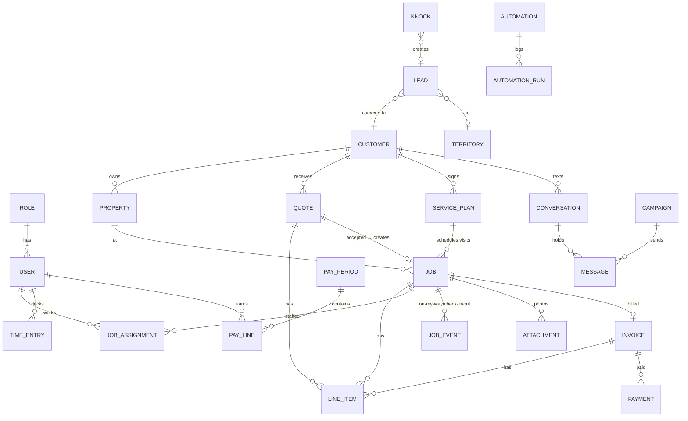

# ZF CRM: Blue work replacement, pre-build schema

_Written 2026-11-22. Goal: run ZF Entretien on our own CRM before Blue work is cancelled (about April 2027)._

## 1. Where the information came from
- **Blue work (Blueworks CRM, blueworks.app):** what the public site, the app stores and the app's own public screens show. There are no public help docs, so the detail of each tab still needs one walk-through of the logged-in app (see section 7).
- **CRMWMB (this repo):** a full code inventory. About 60% of what Blue work does is already built here.

## 2. What Blue work does compared with CRMWMB

| Blue work area | What it does | CRMWMB today | Work needed |
|---|---|---|---|
| Dashboard | Overview + tasks, Sales, Cash flow, Payroll, Expenses, net profit | Basic stats, sales analytics, team sales | Cash flow, expenses, profit |
| Leads / Sales hub | Leads list, D2D map, territories, sales activity, goals | Contacts (status lead), KnockMap, TeamMap, LandscapePipeline | Lead pipeline, territories, goals |
| Customers + properties | Lifecycle New → Upcoming → Active plan → Past (computed) | Contact (one address) | Property table, computed lifecycle |
| Quotes | Line items, tax, discount, 6 templates, sent/viewed/accepted/declined, e-signature, accept → job | ❌ | **New module** |
| Jobs / visits | Duration, multiple techs, line items, notes + photos, "On my way" SMS, check-in/out, checklists | Deal-as-job, multiple techs, calendar, reminders | Line items, check-in/out flow, checklists, photos |
| Schedule | My schedule, tech availability + deadline, Google Calendar push | Calendar, TechSchedule, JobAssignment | Google Calendar sync |
| Service plans | 5-step wizard, visits/year, term, signed agreement, Stripe subscription, ARR board | ❌ | **New module** |
| Invoices | From a job, draft/sent/viewed/paid/refunded, tips, public link, QC tax | HTML/PDF invoice per deal (public link has no token) | Real invoice table, statuses, secure links |
| Payments | Stripe Connect, Tap to Pay, card on file, refunds | ❌ | Stripe (Checkout + saved cards; Tap to Pay later) |
| Payroll | Hourly / commission (tiers), sales commission, tips, locked paid periods | TimeClock, hours log, timesheet | Pay rules (22% of revenue), pay periods |
| Expenses | Expense entries, take-home pay | ❌ | Small new module |
| Communication | Business number, 2-way SMS, mass SMS, team chat | Twilio SMS inbox, campaigns, opt-out, click-to-call | Team chat (optional) |
| Automations | Trigger → action rules | Hard-coded reminders and review requests | Generic rules engine |
| Intake form | Public booking/quote form with pricing questions | Booking page (internal) | Public form that replaces the Make flow |
| Import / export | CSV import with mapping; CSV export of every entity | Contacts CSV + importer script | Export everything; import from Blue work CSVs |
| Roles | View/Manage permission per module, owner, 2FA | admin/user/tech/sales, SMS OTP | Per-module permissions |
| Equipment + contracts | Inventory, signed contracts | ❌ | Later (low priority) |

## 3. Architecture
Keep the current stack and harden it. A rewrite would throw away 56 commits of working ZF-specific code.

```
 Phone / laptop (PWA)        Customers (public links)       Twilio / Stripe / Google
         │                            │                       webhooks │
         └────────────── HTTPS (Caddy, crm.zfentretien.ca) ────────────┘
                                     │
                     FastAPI app (uvicorn, 2 workers)  ── serves the React build
                                     │
             ┌───────────────────────┼─────────────────────────┐
         PostgreSQL 16         Worker (1 process)         File storage
     (all data, Alembic)    reminders, automations,     /srv/zfcrm/files
                            SMS campaigns, GCal sync     (photos, PDFs)
                                     │
                     Nightly pg_dump → off-server backup
```

Key changes from today:
- **Postgres + Alembic** instead of SQLite and the hand-written `ALTER TABLE` code in `main.py`.
- **A separate worker process** for scheduled jobs, so reminders can't be sent twice.
- **Signed tokens on public links** (quotes, invoices, plans, reviews) instead of plain IDs.
- **Tests** (pytest) for money logic: tax, invoices, payroll, plan billing.

## 4. Data model (core tables)



| Table | Main fields |
|---|---|
| `settings` | company name, phone, QC taxes (TPS 5% + TVQ 9.975%), tax numbers, logo, default message templates, review link, discount code |
| `user` / `role` | name, phone, role, per-module `view`/`manage` permissions, commission % (default 22), hourly rate |
| `lead` | name, phone, email, address, lat/lng, source (site/Facebook/D2D/referral), status `new → contacted → quoted → won / lost`, owner, territory, estimate |
| `territory` / `knock` | polygon, assigned rep / pin, outcome (not home, interested, …) |
| `customer` | name, phones, email, language FR/EN, tags[], SMS opt-out, **lifecycle computed** (new, upcoming, active plan, past) |
| `property` | customer, address, lat/lng, notes (number of windows, floors, access) |
| `service` (price book) | name FR/EN, default price, duration, taxable, category (windows, gutters, washing, pavers) |
| `quote` | customer, property, status `draft → sent → viewed → accepted / declined / expired`, discount, signature (image + date + IP), token |
| `line_item` | parent (quote/job/invoice), service, description, qty, unit price (cents), taxable |
| `job` | customer, property, quote?, plan?, start, duration, status `pending → scheduled → on_my_way → in_progress → done / cancelled`, notes, checklist answers |
| `job_assignment` | job, tech, share of pay |
| `job_event` | job, tech, type (on my way, check in, check out), time, GPS |
| `service_plan` | customer, visits per year, term, price, first payment, billing frequency, status `draft → sent → active → past_due / cancelled / expired`, Stripe subscription id, signed agreement |
| `invoice` | job, number, status `draft → sent → viewed → paid / partial / refunded / cancelled`, due date, TPS, TVQ, tip, total, token |
| `payment` | invoice, method (Stripe, e-transfer, cash, cheque), amount, Stripe id, refund |
| `time_entry` | user, clock in, clock out |
| `pay_period` / `pay_line` | dates, locked flag / user, job, rule (22% of revenue, hourly, sales commission), amount, tip |
| `expense` | date, category, amount, taxes, receipt |
| `conversation` / `message` | customer or lead, direction, body, status, campaign |
| `campaign` | segment (tags/lifecycle/city), template, schedule, counts |
| `automation` / `automation_run` | trigger (lead created, quote accepted, job done, invoice overdue, plan renewal…) → action (SMS, email, task, review request) after a delay |
| `attachment` | owner, file path, type |
| `audit_log` | who changed what, when |

## 5. How the main flows work
1. **Lead → customer:** the website intake form (replaces Make) or a D2D knock creates a lead → automatic SMS → quote.
2. **Quote → job:** the customer opens the link, signs, accepts → a job is created → the office schedules it → the tech gets an SMS and the job syncs to Google Calendar.
3. **Job day:** 24 h reminder to the customer → tech taps "On my way" (SMS to the customer) → check-in → checklist + photos → check-out.
4. **Job → money:** job done → invoice created from the job's line items → SMS/email link → Stripe or e-transfer → paid → review request with MERCI20.
5. **Service plan:** sign at the door → Stripe subscription → visits created automatically for the season → each visit follows flow 3.
6. **Payroll:** each completed job gives 22% of revenue to its techs (split per assignment) + tips → pay period locked when paid.

## 6. Build order (until April 2027)

| Phase | When | Content |
|---|---|---|
| 0. Foundation | Dec 2026 | Postgres + Alembic, separate worker, signed links, tests, deploy on the server |
| 1. Money core | Dec–Jan | Price book, quotes + e-signature, line items on jobs, invoices (TPS/TVQ), payments (manual + Stripe) |
| 2. Field | Jan–Feb | On my way, check-in/out, checklists, photos, Google Calendar sync |
| 3. Plans + payroll | Feb | Service plans + Stripe subscriptions, pay periods, expenses, cash-flow dashboard |
| 4. Growth | Mar | Automations engine, public intake form (replaces Make), lead pipeline + territories |
| 5. Migration | Mar | Import Blue work CSV exports (it exports leads, customers, jobs, invoices, quotes, plans) with the same statuses; run both apps side by side for 2 weeks |
| 6. Switch | Apr 2027 | Move the business phone number and the Make/website feed; cancel Blue work |

## 7. Still needed from Fouad
- **One walk-through of the logged-in Blue work app** (screens, settings, automations you actually use). Two options: reconnect the Blue work connector on the server (`/mcp` → "claude.ai Blue work CRM"), or let Claude browse it through the Chrome extension.
- Which Blue work features ZF really uses (for example: equipment, team chat, Tap to Pay).

## 8. Hosting on the ZF Server
Yes, it can run on the current DigitalOcean droplet (Toronto, 40 GB of disk free, Caddy + HTTPS already running for the Noop app).
- **Limit:** RAM. The droplet has 2 GB and only about 440 MB is free, because the always-on Claude uses most of it. The CRM with Postgres needs about 400–600 MB.
- **Recommendation:** resize the droplet to **4 GB / 2 vCPU (≈ US$24/month)**, or run the CRM on its own **2 GB droplet (≈ US$12/month)** so Claude can never crash the CRM. Either option costs well under Blue work's ~$1,000/year.
- **Setup:** `crm.zfentretien.ca` → Caddy → systemd services `zfcrm-web` + `zfcrm-worker` → local Postgres; nightly `pg_dump` to off-server storage; uptime check that alerts the phone.
